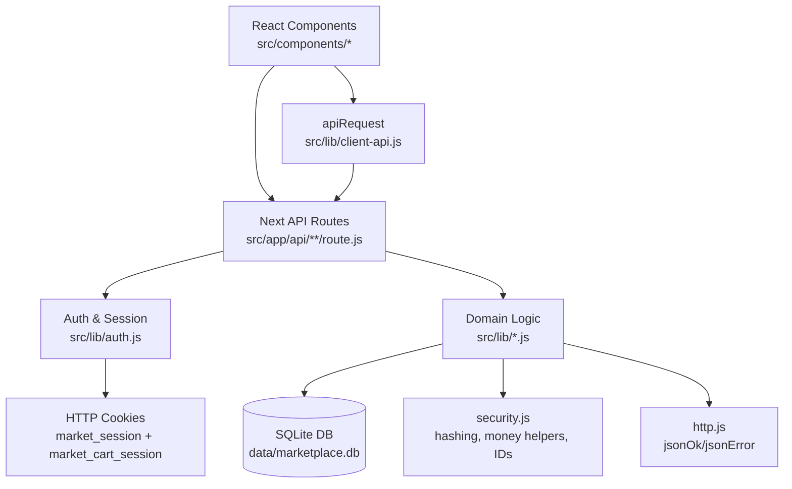

# MarketForge Architecture Guide

## What this app does
MarketForge is an online marketplace where many independent sellers can run stores and sell products, and buyers can shop across all those stores in one place.

A buyer can browse products, filter and sort results, add items from different sellers to one cart, then check out. The app splits that checkout into separate seller orders, tracks order status, and allows reviews after delivery.

A seller can onboard a store, list products with variants, manage inventory, fulfill orders, and track earnings. An admin can monitor platform metrics, approve/reject seller applications, and resolve disputes.

## Tech stack breakdown

### Next.js (App Router)
- Role: full-stack framework for UI + server routes in one project.
- Why chosen: lets this project keep React pages and backend API handlers in one codebase, which is great for learning request/response flow end-to-end.
- Alternative: Express + separate React app. That split is valid, but harder for fundamentals-first learning.

### React 19
- Role: client-side UI state, forms, event handlers, rendering lists.
- Why chosen: this project is state-heavy (filters, cart, multi-step checkout), and React patterns are highly transferable to production jobs.

### Node `node:sqlite` (SQLite)
- Role: persistent relational data for users, products, carts, orders, reviews, payouts.
- Why chosen: zero external DB service needed for local learning, but still teaches SQL, transactions, and data modeling.
- Tradeoff: `node:sqlite` is experimental in Node 22, so you see warnings.

### SQL + prepared statements
- Role: query/update data safely.
- Why chosen: direct SQL makes data transformations explicit so learners can see how app logic maps to DB logic.

### Cookie-based sessions
- Role: login identity + persistent anonymous cart sessions.
- Why chosen: simple, concrete auth/session model that clearly shows request-scoped identity.

### ESLint + Next lint rules
- Role: enforce consistent patterns and catch risky code early.
- Why chosen: teaches production hygiene while coding features.

## Folder structure walkthrough

### `src/app/`
- App Router entry points.
- `page.js`, `layout.js`, route pages (`/cart`, `/checkout`, `/seller`, `/admin`), and API route handlers under `src/app/api/**/route.js`.
- Why organized this way: Next.js convention. UI routes and API endpoints live in predictable, colocated paths.

### `src/components/`
- Client components for interactive UIs.
- Examples: `MarketplaceHome.js`, `CheckoutPage.js`, `SellerPage.js`.
- Why: keeps page wrappers thin and moves interaction/state logic into reusable components.

### `src/lib/`
- Core domain logic and helpers.
- Examples:
  - `db.js`: schema + seed + transaction helper
  - `catalog.js`: filtering/sorting/discovery rules
  - `cart.js`: grouping + cart math
  - `orders.js`: checkout split + inventory safety
  - `seller.js`, `admin.js`, `engagement.js`: role-specific rules
- Why: centralizes business logic so API handlers stay thin.

### `public/`
- Static assets.

### `data/`
- SQLite files (`marketplace.db`, `-wal`, `-shm`).
- Why: local persistence for realistic testing.

### `_learning/`
- Curriculum docs and file guides generated for this project.

## Data flow walkthroughs

## 1) Buyer adds item to cart
1. UI event in `src/components/ProductDetail.js`: user picks variant and quantity, clicks **Add to Cart**.
2. Component calls `apiRequest('/api/cart', { method: 'POST', body: ... })`.
3. API handler `src/app/api/cart/route.js`:
   - resolves identity (`getCurrentUser()` + `getOrCreateCartSessionId()`)
   - calls `addCartItem()` in `src/lib/cart.js`.
4. `addCartItem()` validates variant/product, checks inventory, upserts cart row, updates quantity immutably at DB level.
5. API returns JSON cart snapshot.
6. Component shows success and re-renders with updated state.

## 2) Buyer checkout (multi-seller split)
1. UI stepper in `src/components/CheckoutPage.js` collects address, shipping-per-seller, payment, discount code.
2. Component sends payload to `POST /api/checkout`.
3. `src/app/api/checkout/route.js` calls `checkout()` in `src/lib/orders.js`.
4. `checkout()` runs inside `runInTransaction()`:
   - loads active cart items
   - groups by seller with `.reduce()`
   - computes subtotal/tax/shipping/discount
   - creates one order per seller
   - decrements inventory with conditional update to avoid oversell race
   - writes order history, transactions, payouts, notifications
   - clears active cart items
5. API returns created order IDs.
6. UI shows success and navigates to Orders page.

## 3) Admin resolves a dispute
1. Admin clicks resolve in `src/components/AdminPage.js`.
2. Component calls `PATCH /api/admin/disputes`.
3. API route `src/app/api/admin/disputes/route.js` requires admin role, then calls `resolveDispute()` in `src/lib/admin.js`.
4. Domain function updates dispute status + note and inserts a user notification.
5. Admin dashboard refreshes via `GET /api/admin/analytics`.

## Architecture diagram



## Key design patterns used

### Thin controller pattern (API route as transport adapter)
- Where: most `src/app/api/**/route.js` files.
- Meaning: route parses HTTP input/output, but pushes business rules into `src/lib/*`.
- Why useful: easier testing and reuse of core logic.

### Service/domain module pattern
- Where: `src/lib/orders.js`, `cart.js`, `catalog.js`, `seller.js`, `admin.js`.
- Meaning: each module owns a business area.
- Why: easier to reason about and prevents route duplication.

### Transaction boundary pattern
- Where: `runInTransaction()` in `src/lib/db.js`, used by `checkout()`.
- Meaning: all checkout writes either succeed together or fail together.
- Why: protects money/inventory correctness.

### Data-shaping pipeline pattern
- Where: heavy `.filter().map().reduce().sort()` usage in `catalog.js`, `cart.js`, `orders.js`.
- Meaning: transform raw rows into UI-ready structures step-by-step.
- Why: composable and readable transformations.

### Role-based access control (RBAC)
- Where: `requireUser([roles])` in `src/lib/auth.js` used by admin/seller routes.
- Meaning: route access depends on user role.
- Why: enforces clear security boundaries.

### Optimistic UI with server reconciliation
- Where: several client components update UI after API response (`CartPage`, `ProductDetail`, `SellerPage`).
- Meaning: UI reacts quickly, then syncs with source-of-truth API state.

## How to run locally

1. Install dependencies:
```bash
npm install --no-package-lock
```

2. Run development server:
```bash
npm run dev
```

3. Open `http://localhost:3000`.

### Script reference
- `npm run dev`: start Next.js dev server with hot reload.
- `npm run build`: production build (compilation + route analysis).
- `npm run start`: run built app.
- `npm run lint`: lint checks.

### Seeded demo users
- Admin: `admin@market.dev` / `Admin123!`
- Seller: `seller@market.dev` / `Seller123!`
- Buyer: `buyer@market.dev` / `Buyer123!`

## Notes on current implementation quality
- This codebase is intentionally learning-friendly and explicit.
- It uses SQLite directly instead of Prisma/Postgres/Stripe, which is simpler for fundamentals but not full enterprise infra.
- Checkout correctness patterns (transactions, inventory checks, order split) are production-relevant and worth studying deeply.
